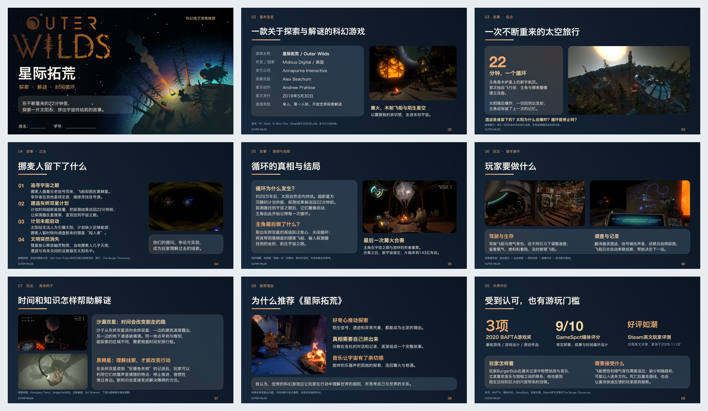

# PPT Design Skills

可复用的 Codex 演示设计 skills。

## Starlight Glass · 星际毛玻璃

复用大标题、渐变半透明文本区、真实图片分区和多种布局的设计方法。**《星际拓荒》只是一个效果示例，后续PPT的配色、背景明暗和图片应根据新主题选择，不默认使用深蓝橙或太空风格。**

### 效果示例 · 九宫格

以下9张是同一份科幻游戏介绍的不同页面，用于展示封面、基础信息、故事、操作、案例、推荐和评价等排版。它们不是要求后续任务照搬的主题样式。

[打开大图查看](skills/artifact-template-starlight-glass/assets/showcase.png)

- [Skill入口](skills/artifact-template-starlight-glass/SKILL.md)
- [设计参数](skills/artifact-template-starlight-glass/references/design-system.md)
- [布局目录](skills/artifact-template-starlight-glass/references/layouts.md)

## 安装与使用

在 Codex 中提出：

> 从 https://github.com/ZCloud211/ppt-design-skills 安装 skills/artifact-template-starlight-glass。

也可以下载仓库ZIP，将 `skills/artifact-template-starlight-glass` 文件夹放入个人 skills 目录 `~/.codex/skills/`，自定义 `CODEX_HOME` 时放入其 `skills/` 子目录。若当前会话未识别新安装的 skill，重新打开会话后使用。

本仓库不上传原PPT，也不提供原PPT下载脚本。配色、字体、尺寸和10种布局已整理为文字规范，无原稿也能使用。预览图仅用于说明视觉方向。

调用示例：

> 用 $artifact-template-starlight-glass 做一份8页城市旅行介绍，参考示例的信息层级与图文排版，按目的地照片选择合适配色。

新任务应使用新内容、新图片与核实后的资料，不沿用旧案例的评分和查询日期。页数由当前任务决定，不固定为10页。

## 素材说明

案例预览包含《星际拓荒》官方图片与有出处的实机截图，相关图片与游戏标识的权利归原权利人，出处见 [素材说明](skills/artifact-template-starlight-glass/assets/SOURCES.md)。公开展示预览不构成对第三方素材的重新授权。用于其他主题时请替换为适用素材。
