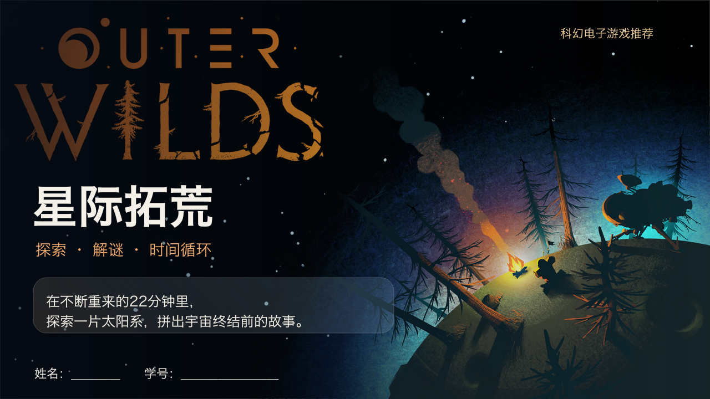

# PPT Design Skills

可复用的 Codex 演示设计 skills。

## Starlight Glass · 星际毛玻璃

从《星际拓荒》课程PPT提取的视觉模板：大标题、圆角渐变半透明文本框、真实图片分区，以及深蓝黑、篝火橙和浅金配色。换成其他主题时可以调整配色和页数。

- [Skill入口](skills/artifact-template-starlight-glass/SKILL.md)
- [设计参数](skills/artifact-template-starlight-glass/references/design-system.md)
- [布局目录](skills/artifact-template-starlight-glass/references/layouts.md)

## 安装与使用

在 Codex 中提出：

> 从 https://github.com/ZCloud211/ppt-design-skills 安装 skills/artifact-template-starlight-glass。

也可以下载仓库ZIP，将 `skills/artifact-template-starlight-glass` 文件夹放入个人 skills 目录 `~/.codex/skills/`，自定义 `CODEX_HOME` 时放入其 `skills/` 子目录。若当前会话未识别新安装的 skill，重新打开会话后使用。

本仓库不上传原PPT，也不提供原PPT下载脚本。配色、字体、尺寸和10种布局已整理为文字规范，无原稿也能使用。预览图仅用于说明视觉方向。

调用示例：

> 用 $artifact-template-starlight-glass 做一份8页科幻电影介绍，沿用大标题、毛玻璃与图文分区，配色改成深紫与青色。

新任务应使用新内容、新图片与核实后的资料，不沿用旧案例的评分和查询日期。页数由当前任务决定，不固定为10页。

## 素材说明

预览图包含《星际拓荒》官方封面素材，相关图片与游戏标识的权利归原权利人，出处见 [素材说明](skills/artifact-template-starlight-glass/assets/SOURCES.md)。公开展示预览不构成对第三方素材的重新授权。用于其他主题时请替换为适用素材。
